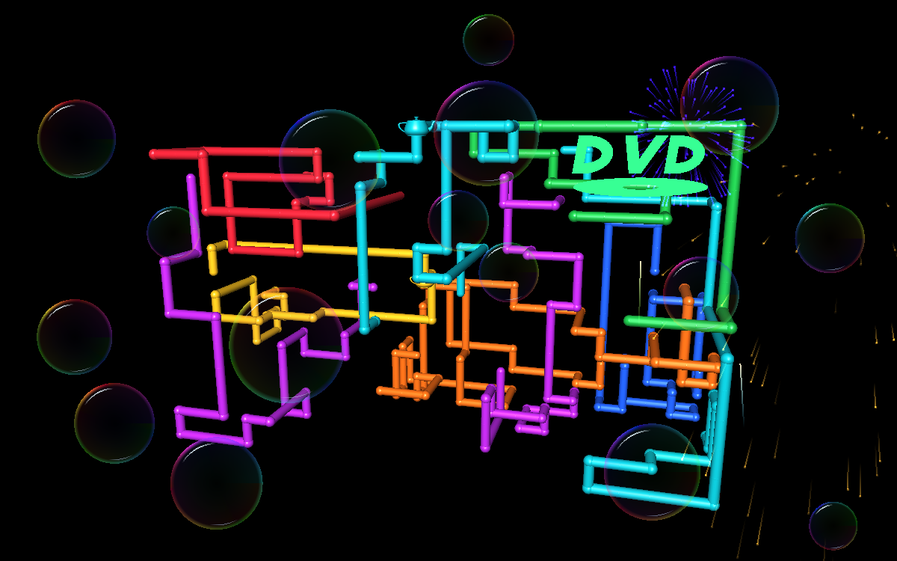
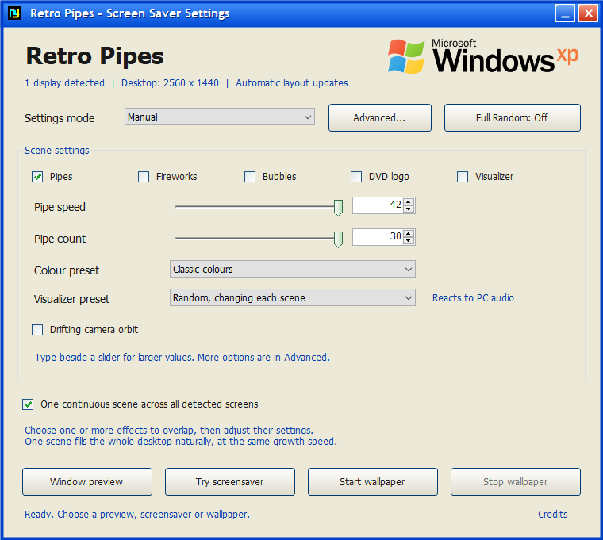
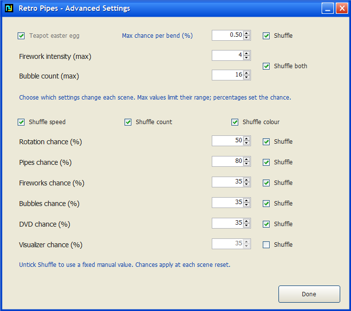
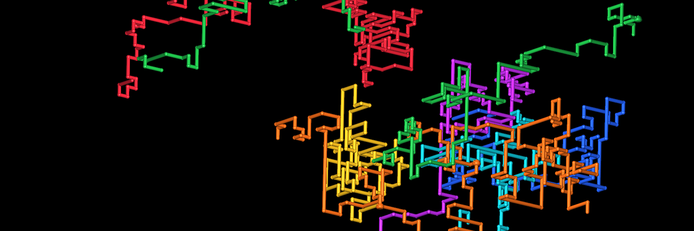
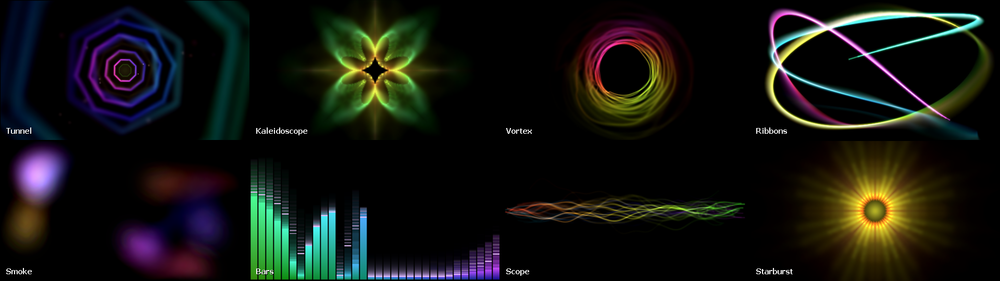
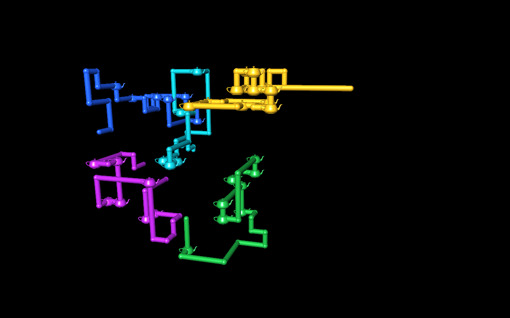
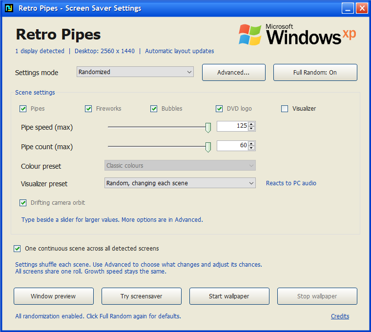

# Retro Pipes

Classic-inspired 3D pipes, fireworks, glass bubbles, a bouncing DVD logo and a music visualizer that reacts to whatever your PC is playing. Run each one alone or overlap them as a live desktop wallpaper, Windows screensaver, or windowed animation. Choose independent scenes per monitor or one continuous scene across all screens.



## Download and run

Download **Retro-Pipes-v1.9.zip** from the [latest release](https://github.com/S0MBRX/retro-pipes/releases/latest), extract it, and open **RetroPipes.exe**.

- **Start wallpaper** animates behind desktop icons. Use its system-tray icon to open controls or stop it.
- **Try screensaver** fills your displays. Move the mouse or press any key to exit.
- **Window preview** supports Space to pause, R for a fresh scene, and Esc to close.
- To use it when Windows is idle, right-click **RetroPipes.scr**, choose **Install**, and configure the wait time in Windows Screen Saver Settings. Keep the files in a permanent folder.

## Settings



The control panel uses an XP-style blue title bar, cream panels, classic buttons, green checkmarks and the Windows XP wordmark. The title bar can be dragged; minimize and close work normally. The header shows the current display count and desktop size.

Choose **Manual** or **Randomized** from the dropdown above one compact settings frame. Tick **Pipes**, **Fireworks**, **Bubbles**, **DVD logo** and/or **Visualizer** to select any combination. Speed, pipe count, colour preset, visualizer preset, a drifting camera orbit and screen layout remain on the main panel. Switching modes preserves entered values.

**Advanced...** opens teapot settings, firework intensity, bubble count, and (in Randomized mode) every individual Shuffle switch and rotation/layer chance. Closing Advanced keeps your edits; hiding the controls does not disable their settings. Existing colour presets remain in the main panel; a custom palette editor is not included.



Custom controls now clear their previous pixels and preserve the graphics clipping region and origin when drawing text. This fixes text escaping its control during partial repaints and prevents old text/checkmarks/slider positions from sticking.

Choose Classic, Electric or Chrome pipe colours, growth speed, pipe count and an optional drifting camera orbit. Firework intensity accepts 1–30; bubble count accepts 1–100. Fireworks launch and burst into fading sparks; translucent iridescent bubbles drift and bounce.

Every layout picks a random starting colour from the selected theme. A single pipe can use any of the theme's colours, including when randomized settings are turned off.

The number boxes accept **speed 1–1000** and **pipe count 1–500**, beyond the sliders' convenient ranges of 1–25 and 1–10. The default values (and randomized upper limits) are speed **25** and count **10**. Larger typed values remain active even though the slider stays at its end. Moving a slider selects a value within its regular range.

### Free-growing pipe shapes

Pipes no longer grow inside a hard rectangular box or fixed shallow depth slab. Every unoccupied neighbouring cell remains eligible, including beyond the screen edges. A smooth, camera-aware preference favours visible space and gently pulls distant growth back toward it. Offscreen travel is still possible; there are no reflecting walls.

Starting points are spread through the current camera view with varied depth. The bias follows the drifting orbit and works over the full shared desktop when spanning. Straight runs and turns remain random, with classic right-angle joints and collision avoidance. Scene complexity budgets and resets still prevent geometry from accumulating forever; these are not spatial boundaries.



### Drifting camera orbit

Tick **Drifting camera orbit** for a slow orbit whose pitch gradually moves above and below the pipe scene. A gentle roll and shifting aim point vary the glide, rather than keeping the same downward angle. Each scene starts at a seeded phase; all views of a spanning scene share the same camera. Pipe growth speed is independent of camera movement. Unticking it restores the fixed view.

### Bouncing DVD logo

Tick **DVD logo** by itself or alongside any other effects. The DVD-Video mark uses an embedded 960-pixel transparent PNG with its original lettering, disc and VIDEO detail, sourced from [Wikimedia Commons](https://commons.wikimedia.org/wiki/File:DVD-Video_Logo.svg). Its alpha channel preserves smooth edges and transparent holes while the renderer applies each bounce colour. The whole logo reflects off screen edges, changes colour on impact, and keeps moving through delayed frames without losing the travelled distance. In separate-screen mode, each screen has its own logo and trajectory. In spanning mode, one logo travels across the combined desktop rectangle, crossing internal monitor boundaries naturally. Monitor gaps within that rectangle can temporarily hide the logo.

**Advanced... → DVD chance** controls whether it appears in randomized scenes. Full Random includes DVD; returning to defaults leaves only pipes selected. A fixed DVD-only scene runs continuously without the other effects' timed resets.


### Music visualizer

Tick **Visualizer** for an audio-reactive background in the spirit of the early-2000s media player visualizations. It listens to whatever is playing through your default playback device (Windows' WASAPI loopback, the same sound you hear), so music, videos and games all drive it. No microphone is used and nothing is recorded, saved or sent anywhere. An in-house FFT splits the sound into bass, mids, treble, overall level and beats. Bass hits push the motion, beats trigger pulses and the colours drift faster with louder music.



There are eight original presets (preview generated from a 120 BPM test signal):

- **Tunnel**: glowing polygon rings leave the centre on bass hits and fly outward through a zooming feedback tunnel.
- **Kaleidoscope**: comets and a rose curve folded into 6 to 12 mirrored wedges, spiralling outward.
- **Vortex**: a circular waveform swirling into a spinning whirlpool.
- **Ribbons**: three Lissajous light trails steered by the bass, mids and treble.
- **Smoke**: soft coloured clouds that curl and drift upward, swelling with the level.
- **Bars**: 32 spectrum bars from 50 Hz to 16 kHz with falling peak caps.
- **Scope**: a triggered oscilloscope wave with a mirrored echo, zooming away.
- **Starburst**: mirrored spectrum spokes radiating from the centre.

Choose a preset in **Visualizer preset** on the main panel. **Random, changing each scene** (the default) picks a new preset every 35 to 60 seconds, never the same one twice in a row, with a short crossfade. Picking one preset keeps it, and only its colours, fold count and shape vary at each change. R in a preview and the tray's **Roll new scenes on every screen** also change it. When nothing is playing, or no playback device can be opened, it fades into a slow, calm idle animation instead of going black, and comes back to life as soon as sound starts. It follows a change of default playback device within about two seconds.

The visualizer sits behind every other layer, so pipes, fireworks, bubbles and the DVD logo can all run on top of it, or tick it alone. In separate-screen mode each monitor gets its own visualizer and preset, all listening to the same sound. With **One continuous scene across all detected screens**, one visualizer covers the whole desktop: a wide desktop is split into mirrored panels about 16:9 each (three side-by-side 16:9 monitors get three), so the pattern meets seamlessly at monitor edges instead of stretching.

The visualizer is off by default and is never switched on unless you ask. **Full Random** leaves it as it is, and restoring the defaults switches it off. To let it appear in random scenes, open **Advanced...** in Randomized mode and tick **Shuffle** beside **Visualizer chance (%)** (35% by default).

It is light on the PC: the feedback effects render at reduced resolution (at most 600 lines per screen), audio capture runs only while a visualizer is showing, and analysis takes a fraction of a millisecond. On the test PC (Radeon RX 7700 XT, three monitors), visualizer wallpaper used about 2.4% of one CPU core and 4% of the GPU, against about 1.7% and 3.5% for fireworks alone.

### Teapot easter egg

Enable **Teapot easter egg** in **Advanced...** for an occasional Utah teapot at a pipe bend. The default chance is **0.5% per bend**; the number box accepts 0–100%. A larger value makes it easier to spot.



### Independent random cycles

Choose **Randomized**, open **Advanced...**, then tick **Shuffle** beside each setting that should change:

- **Pipe speed / Pipe count / Pipe colour** independently randomize those settings. Numbers range from 1 to your entered maxima; colour chooses one of the three themes.
- **Drifting camera orbit** independently chooses rotation on/off using the percentage beside it.
- **Pipes / Fireworks / Bubbles / DVD / Visualizer** independently choose whether each layer appears, using their **% on** values. Unchecked Shuffle options follow your manual choices. Manual switches are dimmed while their Shuffle option controls the result.
- **Shuffle both**, beside firework intensity and bubble count, rolls those amounts from 1 to your entered maxima.
- **Teapot easter egg** shuffles the on/off switch with a 50% chance, and its per-bend probability from zero to your entered maximum. Leave its Shuffle box unticked to keep your preferred probability.

**Full Random** is an on/off toggle. The first click enables all animation layers, rotation, teapots, and every Shuffle category, using your existing numeric limits and probabilities. The music visualizer is the exception: it keeps its own switch and Shuffle setting. It selects Randomized mode; the button reads **Full Random: On**. Each new scene then rolls its settings. It no longer randomly replaces the numbers in the control panel.

Click it again to restore the basic **Manual** defaults: pipes only, speed 25, count 10, Classic colours, rotation off, rare teapots at 0.5%, firework intensity 4, bubble count 16 and the visualizer off. Default shuffle choices and chance percentages are restored too. Your spanning/separate-screen preference is kept in both directions. Preview or start a mode to apply the configuration. The button reflects the current selection of Shuffle categories, including after reopening the app.



In separate-screen mode, each monitor rolls independently on start, when its scene finishes, on R in a preview, or through **Roll new scenes on every screen** in the tray menu. Pipe scenes finish when full; effects-only scenes cycle after 35–60 seconds, except a fixed DVD-only scene, which bounces continuously without timed resets. Random values can occasionally match by chance, but no settings roll is shared across separate scenes.

If all layer rolls are off, one manual layer is kept so the screen is never empty (Visualizer first, then DVD, Fireworks, Bubbles and Pipes). Therefore, layer percentages describe each independent chance roll rather than the final frequency after this fallback. In Manual mode, all screens use your manual settings and generate independent animation paths.

The tray menu's **Current screen settings** shows each monitor's roll. Your saved manual values are preserved.

### One scene across all screens

Tick **One continuous scene across all detected screens**, then start wallpaper or the screensaver. One continuous scene follows the monitor arrangement in Windows Display Settings, including screens to the left of or above the primary screen. Fireworks, bubbles, the DVD logo and the visualizer can share that scene too.

There is no hard-coded monitor count. The app enumerates all connected displays. In spanning mode each monitor renders a matching section of one shared simulation, avoiding a single enormous rendering window. The simulation advances once per frame, irrespective of monitor count. The app automatically starts fresh views when displays are connected, disconnected, resized or rearranged; your selected settings remain in effect. Wallpaper also retries its desktop attachment after Explorer restarts. Available display and graphics hardware still determine practical capacity.

The pipe growth speed and total pipe count are unchanged. The scene gains more space and more capacity, and spanning removes the fixed 105-second pipe-scene cutoff so growth can continue naturally until the scene reaches its geometry budget or pipes get stuck. Pipes follow random paths, so they are not forced to cover every part of the desktop. Set pipe count to **1** for one growing pipe in the shared scene.

Random settings roll once for the entire spanning scene. Untick the option to restore independent scenes and random rolls per monitor. Window preview adopts the desktop's wide/tall aspect ratio. Start wallpaper again to apply changes made to the app's own settings; physical display layout changes are handled automatically.


Settings save when starting a mode or closing the controls. They are stored in `%LOCALAPPDATA%\RetroPipes\settings.xml`.

## Requirements

- 64-bit Windows 10 or 11 with .NET Framework 4.x and OpenGL support.
- No installer, administrator access, network connection, or extra packages are required to run the app.
- The visualizer uses the built-in Windows audio loopback (WASAPI) on the default playback device. Sound from apps using exclusive-mode audio cannot be heard by it.
- Tested on Windows 10. Live wallpaper uses Explorer's WorkerW surface; compatibility may vary with shell changes or other wallpaper apps. Detected display changes and lost desktop attachments trigger automatic rebuilding.
- Wallpaper does not register itself to start with Windows. The app is unsigned.
- This is an original recreation, not Microsoft's original screensaver binary.
- Utah teapot model data comes from freeglut; its license is in [THIRD-PARTY-NOTICES.txt](THIRD-PARTY-NOTICES.txt), embedded in the binary, and available through **Credits** in the app.
- The Windows XP wordmark is sourced from Wikimedia Commons and paired with a vector recreation of the waving flag. Source and attribution details are included in the same credits.

## Build

From the repository folder, run this in PowerShell:

```powershell
.\source\Build.ps1
```

The script uses the C# compiler bundled with 64-bit .NET Framework and produces `RetroPipes.exe` and `RetroPipes.scr` in the repository root. No NuGet dependencies are needed.

## Test

On a Windows desktop, run:

```powershell
New-Item -ItemType Directory -Force work | Out-Null
$process = Start-Process .\RetroPipes.exe -ArgumentList '--self-test work' -Wait -PassThru
if ($process.ExitCode -ne 0) { throw 'Self-test failed. See work/test-error.txt.' }
Get-Content .\work\test-results.txt
```

The tests exercise selective random settings, 0%/100% chances, old-settings migration, extended values, serialization, high-speed growth, dense scenes, collision avoidance, growth through all six former boundaries, positive soft-bias weights and an offscreen return preference, scene cycling, teapot generation, all fifteen layer combinations, three simultaneous independent screen cycles, layouts with 1–64 displays, view rebuilding for 1/5/2 displays, seamless shared projections, rendered-slice comparison against a full scene, unchanged spanning growth speed/count, desktop attachment, bounded effects, OpenGL rendering, preview embedding and launcher controls. UI regression tests check clipped and translated repaints, removal of stale pixels, 30 mode switches, typed overrides, repeated Advanced-dialog opening, Full Random on/off/default restoration and persistence, and teapot randomization. DVD tests cover edges/corners, colour changes, long frames, portrait and panoramic bounds, uninterrupted standalone playback, chance endpoints and saved settings. Camera tests check smooth changing angles and a stable disabled state; shared-view comparisons include the orbit and DVD overlay. Visualizer tests feed a generated 120 BPM test signal (never played aloud) through the FFT and check the bands, bars, beats, 48/192 kHz input and silence; they check that it reacts, fades to idle, cycles all eight presets and keeps a chosen one, that every preset renders non-black both reacting and idle, layered under every other effect and in a tiny preview, that a three-screen spanning slice matches a full-desktop render, that the settings are opt-in, saved and migrated, and that WASAPI loopback opens. The clipping regression fails against the previous drawing code and passes with the fix. Test windows are placed offscreen. Tests leave saved user settings unchanged. Layout tests simulate large monitor counts; physical desktop attachment was tested on a three-monitor setup.

See [README.txt](README.txt) for command-line modes and uninstall instructions.
